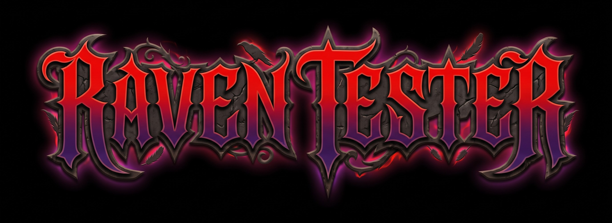

# Raven

Raven es una aplicación de escritorio para Windows que combina un pequeño
cuestionario de redes con acciones sorpresa.



## ¿Cómo funciona?

Al iniciar, aparece un menú con estas opciones:

- **START:** comienza un cuestionario de 20 preguntas sobre redes, direcciones
  IP y subnetting. Hay 3 vidas; una respuesta incorrecta resta una vida y
  ejecuta una broma al azar.
- **SURPRISE:** abre un video en uno de los navegadores compatibles que estén
  instalados.
- **RATE US:** muestra una ventana para calificar el programa.
- **EXIT:** cierra la aplicación.

Las bromas pueden abrir programas o ventanas, simular teclas, mostrar avisos,
consultar la IP pública o usar la cámara y las capturas de pantalla. Algunas
acciones se repiten varias veces. Por ejemplo, una broma puede intentar abrir
un programa 10 veces.

> **Aviso:** Raven puede cambiar temporalmente el estado de las ventanas, abrir
> varias aplicaciones, cerrar y reiniciar el Explorador de Windows y crear
> copias de una foto o captura en el Escritorio. Guarda tu trabajo y ejecuta la
> aplicación solo si estás de acuerdo con esos efectos. La consulta de IP
> requiere conexión a Internet.

## Ejecutar desde el código

Se requiere Windows y Python. Desde la raíz del proyecto, abre PowerShell y
ejecuta:

```powershell
python -m venv .venv
.\.venv\Scripts\Activate.ps1
python -m pip install -r requirements.txt
python Raven.py
```

## Crear el ejecutable

Con las dependencias instaladas, ejecuta desde la raíz:

```powershell
pyinstaller --noconfirm Raven.spec
```

El ejecutable se genera en `dist\Raven.exe`. El archivo de configuración
`Raven.spec` incluye los recursos gráficos de `src\frontend\media`. Si la
compilación informa que no puede reemplazar `Raven.exe`, cierra las instancias
abiertas y vuelve a compilar.

## Recursos gráficos

Las imágenes de la interfaz están en [`src/frontend/media`](./src/frontend/media).
